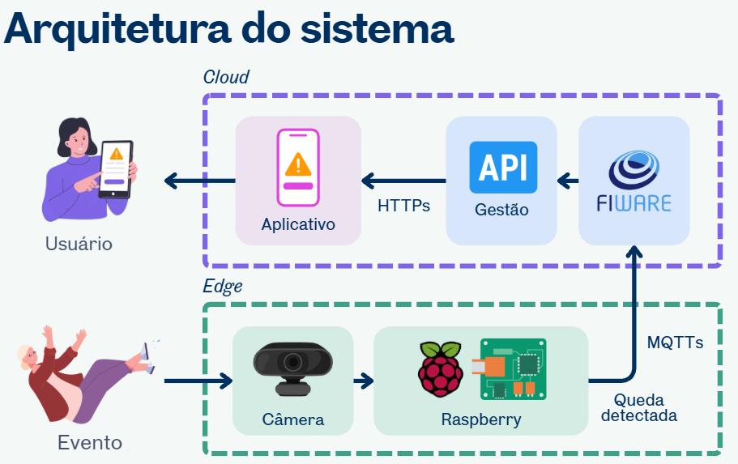
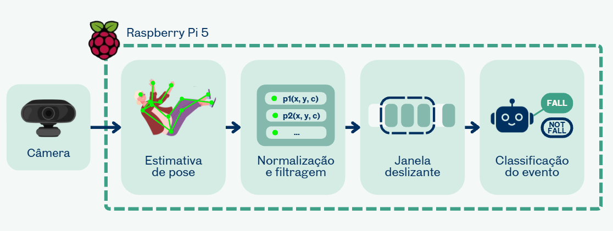

# VIGIA — Sistema doméstico para o monitoramento de quedas

O VIGIA é um sistema de detecção de quedas para ambientes domésticos baseado em visão computacional na borda (edge computing). A análise do vídeo acontece inteiramente em um dispositivo local, sem que nenhuma imagem precise sair da rede da casa, e apenas o evento detectado é enviado à nuvem, que alerta familiares e cuidadores em tempo real pelo aplicativo e pela web.


## Visão geral

O **VIGIA** está presente em todas as etapas do monitoramento. Na **borda**, dentro da casa, acontece toda a captura e observação do ambiente; é ali que a mágica acontece. Na **nuvem**, essas informações são processadas e transformadas em alertas. Por fim, na **interface do usuário**, o aplicativo e a web levam esses alertas a quem precisa acompanhar aquele ambiente, de onde quer que esteja.




### Processamento em borda

A camada de borda concentra o processamento principal do sistema. É nela que as imagens são capturadas e analisadas, sem que nenhum frame precise deixar a rede local. Cada frame passa por um modelo **YOLO (*You Only Look Once*) na versão *pose***, que localiza as pessoas em cena e estima a sua pose, ou seja, a posição de 17 pontos-chave do corpo no padrão COCO (nariz, olhos, ombros, cotovelos, quadris, joelhos, tornozelos etc.). Um rastreador mantém o mesmo identificador para cada pessoa entre frames consecutivos, permitindo acompanhar o movimento de cada corpo individualmente. Os pontos estimados seguem, então, para a pipeline de classificação.



Após a estimativa de pose, a pipeline é composta por três etapas: **normalização**, **janela deslizante** e **classificação**.

**Normalização.** Para cada ponto-chave, o YOLO Pose retorna as coordenadas `x` e `y` em pixels, relativas à imagem, além de um grau de confiança `c`. Utilizadas de forma bruta, essas coordenadas introduzem vieses na detecção: a mesma postura gera valores diferentes conforme a distância da pessoa até a câmera, a sua posição no quadro e o seu tamanho. Para eliminar esses efeitos, os pontos com baixa confiança são descartados e os demais são reescritos em relação ao próprio corpo: centralizados no quadril e escalados pela distância entre ombros e quadril. Dessa forma, o classificador analisa a postura, e não a posição em pixels.

**Janela deslizante.** Uma queda não pode ser identificada a partir de um único frame: trata-se de um movimento que se desenvolve ao longo de um curto intervalo de tempo. Por isso, as poses de cada pessoa são armazenadas temporariamente numa janela que avança continuamente, permitindo classificar a movimentação de cada corpo dentro de um intervalo de tempo. O tamanho da janela depende do classificador: **30 frames** na cadência de análise da placa (12 fps por padrão, cerca de 2,5 s) para o modelo matemático e **20 instantes reamostrados a 10 fps** (2 s) para a rede neural.

**Classificação.** O repositório possui dois modelos de classificação:

- **Matemático (legado):** classifica a movimentação a partir de um conjunto de grandezas cinemáticas e geométricas, como a variação e a velocidade angular do tronco, a razão entre os eixos principais do corpo (PCA) e a aceleração do centro de massa, calculadas sobre pontos suavizados por um filtro de Kalman. Essas grandezas são combinadas num *score* ponderado, avaliado por uma máquina de estados com histerese que exige que o *score* permaneça acima do limiar por alguns frames antes de confirmar a queda. Apesar de ainda presente no código, é considerado um modelo legado.
- **GRU (*Gated Recurrent Unit*):** modelo atual, baseado numa rede neural recorrente. A GRU é uma variante mais enxuta da LSTM, com menos parâmetros e adequada ao processamento na CPU da placa. A cada instante da janela, a rede recebe **37 features**: as 34 coordenadas normalizadas dos 17 pontos-chave (`x` e `y`) e 3 medidas de movimento (velocidades horizontal e vertical e variação da escala do corpo). A inferência ocorre a cada 0,5 s, e a queda só é confirmada após duas predições consecutivas, o que reduz falsos positivos.

### Processamento em nuvem

A camada de nuvem do VIGIA é, no estado atual do projeto, propositalmente enxuta. Ela atua como a **camada de integração** do sistema, ligando os dispositivos embarcados aos usuários, e é formada por duas aplicações que operam em cooperação: a plataforma **FIWARE** e a **VIGIA API**.

**FIWARE.** O [FIWARE](https://www.fiware.org/about-us/) é uma plataforma de código aberto voltada à Internet das Coisas, que gerencia o **contexto** de dispositivos e entidades e atua como ponte entre os dispositivos IoT e os sistemas de controle e análise de dados. O projeto utiliza a distribuição [FIWARE Descomplicado](https://github.com/fabiocabrini/fiware), uma abstração da plataforma oficial que reúne, em Docker Compose, os componentes essenciais para protótipos e provas de conceito:

- **Mosquitto:** broker MQTT que recebe as mensagens das placas;
- **IoT Agent Ultralight:** traduz as mensagens dos dispositivos para o modelo de contexto (NGSI) e entrega a eles os comandos enviados pela nuvem;
- **Orion Context Broker:** mantém o estado atual de cada dispositivo e notifica os serviços inscritos quando esse estado muda;
- **STH-Comet:** armazena o histórico dos atributos.

**VIGIA API.** A API de gestão é responsável pelo cadastro e controle de usuários e dispositivos. Seu principal papel é servir de ponto de ligação entre a interface do usuário e os dispositivos embarcados: ela recebe as ações feitas no aplicativo e na web e as converte em comandos, que chegam à placa por meio do FIWARE. Os comandos disponíveis são descritos na seção [Funcionalidades](#funcionalidades).

#### Fluxo de alerta

No processo de detecção de quedas, o FIWARE é o **gatilho do alerta**. A placa publica o atributo `fall_state` da sua entidade sempre que o resultado da classificação muda; em condições normais, o valor publicado é `normal`. Quando o classificador confirma uma queda, o atributo passa a `fall`. Essa mudança de contexto satisfaz uma *subscription* cadastrada no Orion, que dispara um **webhook** para a VIGIA API.

Ao receber o webhook, a API identifica o dispositivo, localiza todos os usuários vinculados a ele (o dono e os convidados) e abre um **episódio de alerta**. Enquanto nenhum usuário confirmar o alerta, ele é reenviado a cada 2 minutos, até 15 vezes. As notificações são entregues em dois formatos:

- **Push via Firebase Cloud Messaging:** notificação enviada ao celular (Android) e ao navegador dos usuários, que pode ser recebida a qualquer momento, mesmo com o aplicativo fechado.
- **Caixa de notificações:** cada alerta também fica registrado na API e é exibido no ícone de sino do aplicativo e da web. Esse formato não substitui o push; ele foi criado principalmente para permitir a visualização dos alertas no iOS, que ainda não possui um processo de compilação com push habilitado, servindo sobretudo de apoio aos testes de desenvolvimento.


### Interface de usuário

A camada de interface traduz todo o processamento das camadas anteriores em uma experiência simples, pensada para o usuário comum. Por meio dela, os responsáveis monitoram seus ambientes e, diante de um alerta, conseguem verificar à distância o que está acontecendo.

A interface está disponível em duas aplicações, que compartilham as mesmas funcionalidades:

- **Aplicativo mobile** ([`vigia_ui`](vigia_ui/)), desenvolvido em Flutter para Android e iOS. É também por ele que novas placas são pareadas, via Bluetooth;
- **Aplicação web** ([`vigia-web`](vigia-web/)), desenvolvida em Angular e publicada em [vigiadeteccoes.com.br](https://vigiadeteccoes.com.br).

Em ambas, o usuário acompanha a lista de dispositivos com uma miniatura recente de cada ambiente, recebe e confirma alertas, assiste ao vídeo ao vivo e aos clipes das quedas, ajusta as preferências de cada dispositivo e gerencia com quem ele é compartilhado.

### Funcionalidades

Além da detecção e do alerta, o VIGIA oferece recursos de monitoramento, privacidade, colaboração e segurança.

#### Transmissão sob demanda

Permite ao usuário acompanhar o ambiente em tempo real. A transmissão é gerenciada pelo **MediaMTX**: a placa envia o vídeo por RTMP ao servidor, que o redistribui por **WebRTC** ao aplicativo e à web. Para economizar banda e processamento, a placa só transmite enquanto houver alguém assistindo. Quando um usuário abre o vídeo, o MediaMTX avisa a VIGIA API, que envia à placa o comando `stream_on` por meio do FIWARE; quando o último espectador sai, a transmissão é encerrada.

#### Clipes de quedas

Quando habilitada pelo usuário, esta funcionalidade registra os instantes que antecederam cada queda, permitindo entender como a situação ocorreu. A placa mantém em memória uma janela contínua dos últimos 30 segundos de vídeo. As imagens só deixam o dispositivo quando uma queda é detectada: nesse momento, os frames da janela são enviados à VIGIA API, que monta o clipe em MP4 e o armazena no **MinIO**, um servidor de armazenamento de objetos compatível com a API do Amazon S3. O clipe fica disponível no aplicativo e na web, com miniatura e reprodução.

#### Desfoque (blur) de pessoas

Quando ativado pelo usuário, a placa aplica desfoque sobre a região de cada pessoa detectada pelo YOLO. O desfoque não interfere na detecção de quedas, pois o classificador trabalha apenas com os pontos-chave extraídos na estimativa de pose. O efeito se aplica somente às imagens que deixam a placa: a transmissão ao vivo, os clipes de quedas e as miniaturas.

#### Compartilhamento de dispositivos

Cada dispositivo pertence ao grupo do seu dono, que pode convidar outras pessoas para acompanhá-lo. O dono gera um **link de convite** válido por 5 minutos; quem abre o link e faz login passa a integrar o grupo, recebendo os alertas e tendo acesso ao vídeo e aos clipes daquele dispositivo. Cada grupo comporta até 10 usuários, a geração de um novo convite invalida o anterior, e o dono pode remover membros a qualquer momento.

#### Pareamento por Bluetooth (BLE)

A configuração da placa dispensa teclado, monitor ou cabo de rede. Enquanto não está pareada, ela anuncia um serviço Bluetooth Low Energy, e o pareamento segue as etapas abaixo:

1. O aplicativo localiza a placa e lê a sua identidade (`Vigia-xxxxxxxx`, ID e endereço MAC).
2. O aplicativo registra o dispositivo na VIGIA API, que o provisiona no FIWARE, o vincula ao grupo do usuário e emite um **certificado de cliente** exclusivo para a placa.
3. O aplicativo envia à placa, via BLE, a rede Wi-Fi e sua senha, os endereços da API e do servidor de vídeo, a chave do FIWARE e o certificado.
4. A placa se conecta ao Wi-Fi, informa o resultado ao aplicativo e inicia a captura.

O andamento do pareamento também é exibido no display LCD da placa, que oferece um menu local para consultar o Wi-Fi, trocar o modelo de classificação ou desvincular o usuário.

#### Autenticação e segurança

- **Usuários:** login, cadastro e redefinição de senha são gerenciados pelo **Keycloak**, por meio do fluxo *Authorization Code* com **PKCE**. A web utiliza o cliente `vigia-web` e o aplicativo, o cliente `vigia-app`, que exibe a página de login do Keycloak em uma WebView. A VIGIA API valida o *access token* emitido pelo realm `vigia`. Cadastros e alterações de usuário são sincronizados com a API via RabbitMQ, e o logout encerra a sessão no Keycloak e remove o registro de push do aparelho.
- **Mídia:** miniaturas, fotos e clipes são servidos com **tokens efêmeros**, impedindo que os links sejam reaproveitados.
- **Placa → API (mTLS):** o certificado emitido no pareamento (ECDSA P-256, válido por 2 anos e assinado pela autoridade certificadora do VIGIA) autentica a placa nas rotas de envio de frames e clipes. Em produção, essa exigência é controlada pela configuração `DeviceAuth__RequireClientCertificate`.
- **Serviços internos:** os webhooks do Orion e do MediaMTX se autenticam na API com credenciais Basic, e toda a comunicação com a nuvem é cifrada com TLS (HTTPS, MQTTS e RTMPS).

---

## Sobre o repositório

O VIGIA é organizado como um **monorepo**: todas as camadas da solução (borda, nuvem e interface) convivem neste repositório, cada uma em sua própria pasta, com dependências, testes e pipeline de release independentes.

O desenvolvimento segue o fluxo `feat/*` → `develop` → `master`. Todo pull request para `develop` ou `master` passa pelo CI, que executa a validação apenas dos projetos alterados.

### Mapeamento de pastas e projetos

```
vigia/
├── vigia-onboard/        # Serviço da placa: captura + YOLO + classificação, MQTT/FIWARE, streaming, clipes, BLE/Wi-Fi/LCD
├── vigia-bootstrap/      # Control plane legado da placa (substituído pelo vigia-onboard)
├── vigia-api/            # API de gestão (.NET) + bibliotecas compartilhadas e testes
├── vigia-web/            # Interface web (Angular)
├── vigia_ui/             # Aplicativo mobile (Flutter, Android/iOS)
├── vigia-devices/        # Worker que simula dispositivos na nuvem (demonstrações)
├── vigia-lab/            # Bancada de captura e avaliação dos classificadores (roda no notebook)
├── seed-codes/           # Utilitários de desenvolvimento (seed do edge local, envio de frames e clipes)
├── docker-compose/
│   ├── local/            # Stack completa de desenvolvimento
│   ├── deploy/           # Stack de produção da VM (infra.sh + docker-compose.yaml)
│   └── dockerfiles/      # Dockerfiles da API, web, worker, Keycloak e MediaMTX
├── docs/                 # Documentação técnica (estrutura, Raspberry Pi, FIWARE, diagramas)
├── edge-data/            # device.json mock do edge local (gerado pelo seed; ignorado pelo Git)
└── .github/workflows/    # CI (quality gate) e pipelines de release
```

| Projeto | Descrição | Ponto de entrada | Documentação |
|---------|-----------|------------------|--------------|
| [`vigia-onboard`](vigia-onboard/) | Serviço único da placa (`vigia.service`): processos de captura, integração e interface | `main.py` / `Makefile` | [`docs/DEPLOY.md`](vigia-onboard/docs/DEPLOY.md) |
| [`vigia-bootstrap`](vigia-bootstrap/) | Control plane anterior ao `onboard` (pareamento BLE, Wi-Fi, LCD) | `main.py` / `Makefile` | [`docs/DEPLOY.md`](vigia-bootstrap/docs/DEPLOY.md) |
| [`vigia-api`](vigia-api/) | API REST + SignalR. Bibliotecas `Vigia.Models`, `Vigia.Database`, `Vigia.Fiware`, `Vigia.Cache`, `Vigia.Cloud`, `Vigia.AMQP` | `Vigia.API/Program.cs` (base path `/vigia`) | [`docs/fiware.md`](docs/fiware.md) |
| [`vigia-web`](vigia-web/) | SPA Angular (camadas `core` / `pages` / `shared`) | `src/main.ts` | [`README`](vigia-web/README.md) |
| [`vigia_ui`](vigia_ui/) | App Flutter (camadas `core` / `domain` / `data` / `presentation`) | `lib/main.dart` | [`README`](vigia_ui/README.md) |
| [`vigia-devices`](vigia-devices/) | Simula até 7 dispositivos: vídeo em loop, stream, miniaturas e quedas aleatórias | `main.py` | [`README`](vigia-devices/README.md) |
| [`vigia-lab`](vigia-lab/) | Captura cenas rotuladas e compara os classificadores (Math, GRU 34/37/38) | `python -m vigia_lab` / `Makefile` | [`README`](vigia-lab/README.md) |
| [`seed-codes`](seed-codes/) | `make seed`, `make publish-frame`, `make publish-clip`, `make convert` | `Makefile` | — |
| [`docker-compose`](docker-compose/) | Orquestração local e de produção | `local/` e `deploy/` | [`project-structure.md`](docs/project-structure.md#docker-compose) |

A descrição módulo a módulo de cada projeto está em [`docs/project-structure.md`](docs/project-structure.md).


### Tecnologias utilizadas

| Camada | Tecnologias |
|--------|-------------|
| **Edge** | Raspberry Pi 5 · Raspberry Pi OS Lite 64-bit · Python 3.12 · Ultralytics YOLO pose (NCNN) · OpenCV · ONNX Runtime (GRU) · paho-mqtt · `bless` (BLE) · NetworkManager · FFmpeg · PyInstaller · systemd |
| **API** | .NET 10 · ASP.NET Core · Entity Framework Core + Npgsql · SignalR · Redis · RabbitMQ · Firebase Admin · Swagger/OpenAPI |
| **Infraestrutura** | Docker / Docker Compose · Traefik v3 · PostgreSQL 15 · Redis · MinIO · Keycloak 26 · RabbitMQ · MediaMTX · Portainer |
| **FIWARE** | Orion Context Broker · IoT Agent Ultralight · Mosquitto (MQTT/MQTTS/WSS) · STH-Comet · MongoDB |
| **Mobile** | Flutter (Dart ≥ 3.12) · Riverpod · go_router · dio · flutter_blue_plus · flutter_webrtc · signalr_netcore · Firebase Cloud Messaging (Android) · i18n pt/en/es |
| **Web** | Angular 22 · Optimus UI 2 · Tailwind CSS 4 · ngx-translate · Keycloak (Authorization Code + PKCE) · Vitest · pnpm · Cloudflare Pages |
| **Pesquisa / ML** | `vigia-lab`: captura e avaliação dos classificadores com o mesmo pipeline da placa |
| **CI/CD** | GitHub Actions · Docker Hub · Portainer · Cloudflare Pages · gitleaks · bandit |

### Pré-requisitos

| Ferramenta | Versão | Usada em |
|------------|--------|----------|
| Git | — | todo o repositório |
| Docker + Docker Compose | Docker Desktop recente | stack local, builds ARM64 em hosts não-ARM |
| .NET SDK | 10.0 | `vigia-api` |
| Python | 3.12 ou 3.13 | `vigia-onboard`, `vigia-bootstrap`, `vigia-devices`, `vigia-lab`, `seed-codes` |
| FFmpeg | no `PATH` | streaming e clipes (`vigia-onboard`, `vigia-devices`, `seed-codes`) |
| GNU Make | — | `vigia-onboard`, `vigia-bootstrap`, `seed-codes`, `vigia-lab` (no Windows, use o Make com Git Bash) |
| Node.js + pnpm | Node 22 · pnpm 11 | `vigia-web` |
| Flutter SDK | stable (Dart ≥ 3.12) · Java 17 para o Android | `vigia_ui` |

Credenciais que **não** são versionadas e precisam ser obtidas à parte:

- Firebase: `vigia_ui/android/app/google-services.json`, `vigia-web/public/firebase-config.js` e a service account da API (`docker-compose/local/firebase-service-account.json`, a partir do `.example`). Sem elas o sistema funciona, mas sem push.
- Arquivos `.env` de cada projeto, criados a partir dos respectivos `.env.example`.

---

## Como instalar

A instalação em produção é dividida entre a **nuvem** (uma VM Linux com Docker e o Cloudflare Pages) e a **borda** (o Raspberry Pi 5 instalado na casa do usuário). Em um ambiente novo, siga a ordem abaixo; depois disso, cada componente pode ser atualizado de forma independente pelo seu workflow de release.

1. Infraestrutura base da VM (`infra.sh`)
2. Stack de aplicação da VM (`docker-compose.yaml`)
3. API (`service-release`)
4. Web (`web-release`)
5. Placa (`onboard-release` + instalação no Raspberry Pi)
6. Aplicativo (`mobile-release`)

### Visão geral das versões

Cada componente tem um workflow de release **manual** (`workflow_dispatch`) no GitHub Actions. Ao final, o workflow move uma **tag rolling** (sobrescrita a cada release) que identifica a última versão publicada.

| Componente | Workflow | Tag | Artefato | Destino |
|------------|----------|-----|----------|---------|
| API | `service-release.yml` | `service` | Imagem `pedroreis16/vigia-api:latest` | VM (Docker), redeploy via Portainer |
| Web | `web-release.yml` | `web` | Build estático Angular | Cloudflare Pages (`vigiadeteccoes.com.br`) |
| Worker de simulação | `worker-release.yml` | `worker` | Imagem `pedroreis16/vigia-devices:latest` | VM (Docker), redeploy via Portainer |
| Serviço da placa | `onboard-release.yml` | `onboard` | `vigia-onboard-deploy.zip` | Raspberry Pi 5 |
| Bootstrap (legado) | `bootstrap-pipeline.yml` | `bootstrap` | `vigia-bootstrap-deploy.zip` | Raspberry Pi 5 |
| App mobile | `mobile-release.yml` | `mobile` | APK assinado | Google Drive |

### Secrets do GitHub Actions

Os workflows de release dependem dos seguintes secrets, configurados em *Settings → Secrets and variables → Actions*:

| Secret | Usado em |
|--------|----------|
| `DOCKERHUB_USERNAME`, `DOCKERHUB_TOKEN` | Publicação das imagens da API e do worker |
| `PORTAINER_WEBHOOK_URL`, `PORTAINER_DEVICES_WEBHOOK_URL` | Redeploy da API e do worker na VM |
| `CLOUDFLARE_API_TOKEN`, `CLOUDFLARE_ACCOUNT_ID` | Publicação da web no Cloudflare Pages |
| `FIREBASE_WEB_CONFIG_JSON_BASE64` | Configuração do push na web |
| `GOOGLE_SERVICES_JSON_BASE64`, `FIREBASE_OPTIONS_DART_BASE64` | Configuração do Firebase no aplicativo |
| `MOBILE_PRODUCTION_ENV` | Variáveis de produção do aplicativo |
| `ANDROID_KEYSTORE_BASE64`, `ANDROID_KEYSTORE_PASSWORD`, `ANDROID_KEY_ALIAS`, `ANDROID_KEY_PASSWORD` | Assinatura do APK |

### Cloud — infraestrutura da VM

A produção roda numa VM Linux com Docker, em `/home/ubuntu/dockers`. A instalação é feita em duas etapas:

**1. Infraestrutura base (`infra.sh`)** — sobe, com `docker run`, a rede `vigia-network`, Redis, PostgreSQL, MinIO, Traefik (TLS Let's Encrypt via DNS da Cloudflare), MediaMTX, Portainer e a stack FIWARE (MongoDB, Orion, IoT Agent, STH-Comet e Mosquitto).

```bash
cp docker-compose/deploy/infra.env.example .env   # na VM, ao lado do infra.sh
bash infra.sh
```

O `.env` precisa, no mínimo, de `CLOUDFLARE_DNS_API_TOKEN`, `MOSQUITTO_IOTAGENT_PASSWORD`, `MOSQUITTO_DEVICE_PASSWORD` e `PORTAINER_ADMIN_PASSWORD` (mínimo de 12 caracteres).

| Domínio | Uso |
|---------|-----|
| `services.vigiadeteccoes.com.br` | API (`/vigia`), Keycloak (`/auth`), FIWARE e stream |
| `ingest.vigiadeteccoes.com.br:8443` | Ingestão RTMPS do vídeo das placas |
| `mqtt.vigiadeteccoes.com.br:8883` | MQTTS das placas (DNS-only na Cloudflare) |
| `mosquitto.vigiadeteccoes.com.br` | MQTT sobre WSS |
| `portainer.vigiadeteccoes.com.br` | Painel do Portainer |

**2. Stack de aplicação (`docker-compose.yaml`)** — RabbitMQ, Keycloak (com inicialização do schema no Postgres e reaplicação do realm), API e worker de simulação.

```bash
cp docker-compose/deploy/.env.example default.env   # variáveis da API (ASP.NET Core, Section__Key)
# o mesmo .env do infra.sh (modelo: infra.env.example) também traz RABBITMQ_PASSWORD,
# POSTGRES_ADMIN_PASSWORD, KEYCLOAK_DB_PASSWORD, KEYCLOAK_ADMIN_PASSWORD…
docker compose -p vigia up -d
```

A CA usada para emitir os certificados de cliente das placas fica em `./certificates` (montada na API e no Traefik). O mTLS das rotas da placa é controlado por `DeviceAuth__RequireClientCertificate`.

### Cloud — API (`service`)

1. Execute o workflow **service-release** no GitHub Actions.
2. O pipeline roda os testes .NET e a verificação de segurança, gera a imagem com `docker-compose/dockerfiles/vigia-api.dockerfile`, publica `pedroreis16/vigia-api:latest` no Docker Hub e chama o webhook do Portainer, que recria o container na VM.
3. As migrations do banco são aplicadas automaticamente na inicialização da API, e o schema FIWARE (`Fiware:Devices`) é sincronizado com os dispositivos já provisionados.

### Cloud — Web (`web`)

1. Execute o workflow **web-release**.
2. O pipeline roda lint, testes e `ng build --configuration=production`, injeta a configuração do Firebase a partir dos secrets e publica no projeto `vigia-web` do Cloudflare Pages.
3. O `public/_worker.js` repassa `vigiadeteccoes.com.br/auth` para o Keycloak da VM, e o `_redirects` garante o fallback da SPA (`/invite/*`, `/*` → `index.html`).

### Cloud — Worker de simulação (`worker`)

Execute o workflow **worker-release**. A imagem `pedroreis16/vigia-devices:latest` é gerada com os vídeos de `vigia-devices/assets/videos/` embutidos e o container é recriado via webhook do Portainer (`PORTAINER_DEVICES_WEBHOOK_URL`).

### Edge — Serviço da placa (`onboard`)

O pacote `onboard` instala **um único serviço**, `vigia.service`, em `/opt/vigia/onboard/`. Ele substitui as instalações antigas de `vigia-bootstrap` e `fall-detection`, que são desativadas automaticamente se existirem.

**Pré-requisito:** a placa precisa estar com o Raspberry Pi OS Lite 64-bit instalado e acessível por SSH. O passo a passo de preparação (hostname, SSH por chave, Tailscale e Wi-Fi) está em [`docs/raspberry-pi.md`](docs/raspberry-pi.md).

**Gerar o pacote**

- Pelo CI: execute **onboard-release** (build nativo em runner ARM64).
- Localmente, na pasta `vigia-onboard/`:

  ```bash
  make ensure-model         # exporta o YOLO pose para NCNN
  make build-linux-arm64    # nativo em linux/arm64; nos demais hosts usa Docker buildx
  ```

**Instalar na placa**

```bash
scp vigia-onboard-deploy.zip vigia@vigia.local:/tmp/
ssh vigia@vigia.local
cd /tmp
unzip -o vigia-onboard-deploy.zip -d vigia-onboard-deploy
sudo ./vigia-onboard-deploy/install-on-board.sh
```

O instalador adiciona `ffmpeg`, as bibliotecas de runtime do OpenCV, `liblgpio1` e `i2c-tools`, habilita o I2C do LCD e ativa o `vigia.service`.

```bash
systemctl status vigia.service
journalctl -u vigia.service -n 80 --no-pager
```

**Primeiro uso:** o serviço sobe aguardando o pareamento. Pelo app, o usuário encontra a placa via BLE, envia o Wi-Fi e recebe a identidade do dispositivo, o certificado de cliente e a URL de ingestão de vídeo; tudo é gravado em `/opt/vigia/device.json` e a captura é liberada.

**Desinstalar:**

```bash
sudo vigia-uninstall                # mantém device.json e .env
sudo vigia-uninstall --purge-data   # remove também identidade e rede (será preciso parear de novo)
```

Configurações opcionais (`FRAME_RATE`, `CLASSIFIER`, `YOLO_MODEL`) podem ser definidas em `/opt/vigia/.env`. Detalhes em [`vigia-onboard/docs/DEPLOY.md`](vigia-onboard/docs/DEPLOY.md).


### Mobile (`mobile`)

1. Execute o workflow **mobile-release**.
2. O pipeline passa por preflight, verificação de segredos, análise estática e testes, gera o APK assinado com `production.env` e o publica na pasta do Google Drive configurada em `GDRIVE_FOLDER_ID`.
3. Baixe o APK dessa pasta e instale no aparelho Android (é preciso permitir a instalação de fontes desconhecidas).
4. No iOS não há release automatizada: o build é feito localmente pelo Xcode, com um iPhone conectado, usando `flutter run --release`. O push (FCM) está disponível apenas no Android.